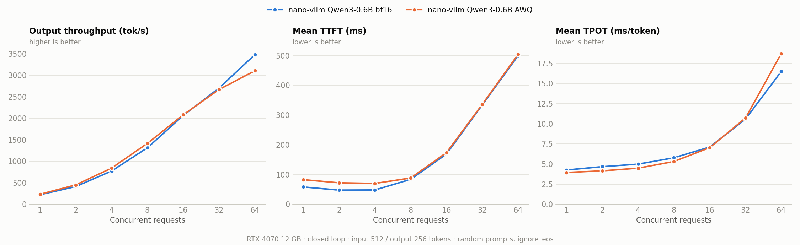
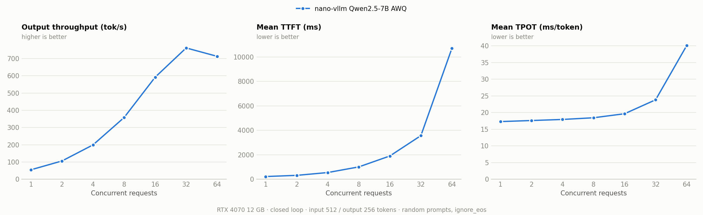

<p align="center">

</p>

<p align="center">
<a href="https://trendshift.io/repositories/15323" target="_blank"></a>
</p>

# Nano-vLLM

A lightweight vLLM implementation built from scratch.

## Key Features

* 🚀 **Fast offline inference** - Comparable inference speeds to vLLM
* 📖 **Readable codebase** - Clean implementation in ~ 1,200 lines of Python code
* ⚡ **Optimization Suite** - Prefix caching, Tensor Parallelism, Torch compilation, CUDA graph, etc.

## Installation

```bash
pip install git+https://github.com/GeeeekExplorer/nano-vllm.git
```

## Model Download

To download the model weights manually, use the following command:
```bash
huggingface-cli download --resume-download Qwen/Qwen3-0.6B \
  --local-dir ~/huggingface/Qwen3-0.6B/ \
  --local-dir-use-symlinks False
```

## Quick Start

See `example.py` for usage. The API mirrors vLLM's interface with minor differences in the `LLM.generate` method:
```python
from nanovllm import LLM, SamplingParams
llm = LLM("/YOUR/MODEL/PATH", enforce_eager=True, tensor_parallel_size=1)
sampling_params = SamplingParams(temperature=0.6, max_tokens=256)
prompts = ["Hello, Nano-vLLM."]
outputs = llm.generate(prompts, sampling_params)
outputs[0]["text"]
```

## Benchmark

See `bench.py` for benchmark.

**Test Configuration:**
- Hardware: RTX 4070 Laptop (8GB)
- Model: Qwen3-0.6B
- Total Requests: 256 sequences
- Input Length: Randomly sampled between 100–1024 tokens
- Output Length: Randomly sampled between 100–1024 tokens

**Performance Results:**
| Inference Engine | Output Tokens | Time (s) | Throughput (tokens/s) |
|----------------|-------------|----------|-----------------------|
| vLLM           | 133,966     | 98.37    | 1361.84               |
| Nano-vLLM      | 133,966     | 93.41    | 1434.13               |

## What this fork adds

### AWQ 4-bit inference: Qwen2.5-7B on a 12 GB GPU

A 7.6B-parameter model needs 15.2 GB in fp16. With AWQ int4 weights it takes 5.2 GiB, leaving room for the paged KV cache on an RTX 4070 (12 GB).

- **Loading** ([linear.py](nanovllm/layers/linear.py)): quantized layers hold `qweight / qzeros / scales` in AWQ's transposed, 8×-packed layout. Each parameter is tagged with `output_dim / input_dim / pack_factor`, so the same tensor-parallel weight loaders handle both the dense and the AWQ layouts, including fused QKV and gate/up projections.
- **Fused Triton kernel** ([awq_triton.py](nanovllm/layers/quantization/awq_triton.py)): for decode-sized batches (≤ 256 tokens), int4 tiles are unpacked and dequantized in registers right before `tl.dot`, so the fp16 weight is never written to memory. Each packed int32 is loaded once and replicated 8× with `tl.interleave`, AWQ's `[0,2,4,6,1,3,5,7]` nibble order is folded into a per-column shift vector, and split-K fills the GPU when M and N are small. Prefill batches use a Triton dequant kernel plus cuBLAS instead.
- **CUDA-graph compatible**: no host-to-device copies on the hot path.

Kernel latency on an RTX 4070 at batch size 1 (µs):

| Layer (K × N) | dense fp16 | dequant + matmul | **fused AWQ** |
|---|---:|---:|---:|
| 7B gate_up 3584 × 37888 | 683 | 2549 | **299** |
| 7B down 18944 × 3584 | 315 | 1217 | **197** |
| 7B qkv 3584 × 4608 | 106 | 295 | **63** |

Quality (WikiText-2 test, full split, 2048-token windows, [benchmarks/ppl.py](benchmarks/ppl.py)):

| Model | Weights | Perplexity |
|---|---|---:|
| Qwen3-0.6B | bf16 | 20.29 |
| Qwen3-0.6B-AWQ | int4, group 128 | 23.87 (+17.7%) |

### Serving benchmark: concurrency sweep

[benchmarks/sweep.py](benchmarks/sweep.py) runs a closed loop where C users each keep one request in flight (512 input / 256 output tokens, random prompts, `ignore_eos`). It reports output throughput, time to first token (TTFT) and time per output token (TPOT). The same script drives vLLM's `LLMEngine` with `--backend vllm`.

```bash
python -m benchmarks.sweep --model ~/huggingface/Qwen2.5-7B-Instruct-AWQ --out results/nanovllm_qwen2.5-7b-awq.json
python -m benchmarks.plot results/nanovllm_qwen2.5-7b-awq.json --out assets/bench_7b_awq.png
```

**Qwen3-0.6B, bf16 vs AWQ int4** (RTX 4070 12 GB):



AWQ has lower per-token latency while decode is memory-bound (TPOT 4.0 vs 4.3 ms at C=1, 5.3 vs 5.8 ms at C=8). bf16 overtakes it at C=64 (3481 vs 3106 tok/s), where the batch becomes compute-bound and cuBLAS beats the fused kernel. AWQ's TTFT is about 25 ms higher at low concurrency because prefill dequantizes every layer.

**Qwen2.5-7B-Instruct-AWQ** (RTX 4070 12 GB, `gpu_memory_utilization=0.85`):



| Concurrency | Output tok/s | TTFT mean (ms) | TPOT mean (ms) |
|---:|---:|---:|---:|
| 1 | 55 | 225 | 17.3 |
| 4 | 200 | 551 | 17.9 |
| 16 | 592 | 1905 | 19.7 |
| 32 | **762** | 3569 | 23.8 |
| 64 | 713 | 10708 | 40.1 |

Throughput peaks at C=32. At C=64 the requests need more KV cache than the ~4 GiB left after weights, so the scheduler preempts and TTFT jumps. This is the memory wall of a 12 GB card. TTFT grows with C partly because the closed loop with fixed output lengths makes requests arrive in synchronized waves, so each wave's prefill is batched together.

Raw results live in [results/](results/).

### Other additions

- OpenAI-compatible server: `/v1/chat/completions` with SSE streaming ([entrypoints/openai](nanovllm/entrypoints/openai)). It serves one request at a time.
- Windows support (gloo backend, triton-windows).
- Tests: `python -m tests.test_awq`, `tests.test_awq_linear`, `tests.test_awq_triton`, `tests.test_awq_model [model_path] [--cuda-graph]`.


## Star History

[](https://www.star-history.com/#GeeeekExplorer/nano-vllm&Date)